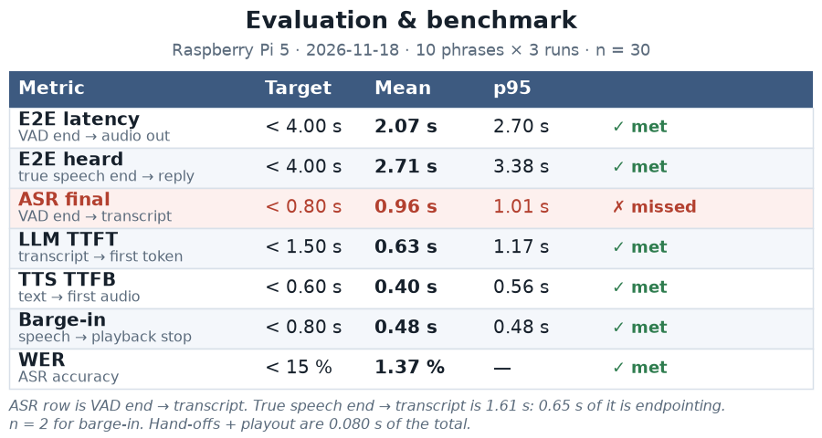

# Evaluation and benchmark

Run `2026-11-18_18-27-10` · 2026-11-18 · Raspberry Pi 5 Model B (8 GB)
Harness <https://github.com/trueshotjames/ai231-me3-full-duplex-benchmarking>
@ `57eaddbc`, adapted via `bench/assistant_entry.py`.



## Results

| Metric | Definition | Target | Mean | p95 | n | |
|---|---|---|---|---|---|---|
| E2E latency | VAD end → audio out | < 4.00 s | 2.07 s | 2.70 s | 30 | met |
| ASR final | VAD end → transcript | < 0.80 s | 0.96 s | 1.01 s | 30 | **over** |
| LLM TTFT | transcript → first token | < 1.50 s | 0.63 s | 1.17 s | 30 | met |
| TTS TTFB | text → first audio chunk | < 0.60 s | 0.40 s | 0.56 s | 30 | met |
| Barge-in | speech → playback stopped | < 0.80 s | 0.48 s | 0.48 s | 2 | met |
| WER | ASR accuracy on test set | < 15 % | 1.37 % | — | 30 | met |

| Metric | Definition | Mean | p95 | n |
|---|---|---|---|---|
| E2E heard | true speech end → reply audio | 2.71 s | 3.38 s | 30 |
| Endpointing | true speech end → VAD end | 0.65 s | 0.69 s | 30 |

E2E passes with 1.9 s of headroom. The breakdown is the useful part: ASR 46 %,
LLM TTFT 31 %, TTS TTFB 19 %, hand-offs and playout 0.080 s. The pipeline itself
is not the problem.

## How it was measured

- **One clock**, the Pi's monotonic clock. Every stage timestamped as it crosses:
  `VAD end → ASR final → LLM 1st token → TTS 1st audio → speaker`.
- **E2E = speaker − VAD end.** Barge-in = stop − speech start.
- **10 phrases × 3 runs** = 30 turns, plus 10 turn-taking trials, 40 in total in
  13 minutes. Mean + p95; JSON log per run, per turn `stages.jsonl`.
- **Tools off.** This measures turn-taking and stage latency, not tool use, and
  the MCP bridge costs ~5 s of startup per run.
- **No AEC.** The harness replaces mic and speaker with a websocket, so the echo
  path a real room has is absent.

## The ASR row: five readings of the same 30 turns

`asr_final` is computed as `asr_final_mark − vad_end_mark`, but `report/deck.py`
labels it "end of speech → transcript", and `vad_end` is 0.65 s *after* speech
ends. Recomputed from the marks the run already wrote — no rerun, no audio:

| Reading | Mean | p95 | vs 0.80 s |
|---|---|---|---|
| A  VAD end → transcript (as shipped) | 0.956 s | 1.012 s | over |
| B  true speech end → transcript | 1.607 s | 1.680 s | over |
| C  true speech end → last streaming partial | 0.495 s | 0.580 s | met |
| D  VAD end → last streaming partial | **−0.157 s** | −0.067 s | met |
| E  whisper second pass alone (log clock) | 0.961 s | 1.017 s | over |

Row A reproduces the shipped 0.9556 exactly through the harness's own
`turn_stages`, so this is the same marks, not a rival reading.

**D is negative on every turn.** The streaming text is complete 157 ms *before*
the VAD declares the turn over: the recogniser contributes zero stage latency.
All 0.96 s is the optional whisper `tiny.en` pass. E confirms it on an
independent clock, agreeing with A to 5 ms mean and 34 ms max.

The decomposition closes, which is what makes it trustworthy: 0.652 + 0.956 +
0.633 + 0.396 + 0.080 = 2.712 s against a measured `e2e_heard` of 2.712 s.

## What the miss costs, and what fixing it costs

With `ASR_FINAL_PASS=none` the heard end-to-end falls **2.71 → 1.76 s**, a 0.95 s
saving — the largest single win available on this Pi. The catch is nearly fatal:

| Text used | WER | vs 15 % |
|---|---|---|
| whisper final (shipped) | 1.37 % | met |
| streaming flushed | **15.07 %** | at the limit |

Observed streaming output: `SUMMERIZED DAY TO PRIVACY CLEARLY`,
`HOW CAN I PROTECT MY ON MINE ACCOUN`. Turning the pass off buys 0.95 s for ~14
points of WER and lands *on* the threshold, not under it. So the fix is not
"remove it" but "make it cheaper": `tiny.en` runs at 3.6× realtime, and the pass
is serial — one model instance behind one thread.

## Turn-taking

| Metric | Rate | n |
|---|---|---|
| Missed turn-taking (failed to answer when addressed) | **0 %** | 2 |
| False turn-taking (answered when not addressed) | **100 %** | 2 |

WanDog has **no notion of address**. Silero VAD answers "is this speech?", not
"is this speech for me?", so any speech in the room opens a turn. It answered a
TV clip and a side remark. **40 `false_tt` clips are on disk**; the run used 2,
because `suites.py` sets `per_round: 2`. That is the first thing to fix before
the deck quotes this rate.

## Machine state during the run

| | |
|---|---|
| Board | Raspberry Pi 5 Model B Rev 1.0, 8 GB |
| Cooling | not stated · peak 68.9 °C · never throttled |
| CPU | median 6.9 %, busiest core p95 72.3 % |
| Network | cloud over Wi-Fi · benchmark link same machine, ~2 ms |
| Software | Pipecat 1.15.0 · sherpa-onnx streaming zipformer `en-2023-06-26` + faster-whisper `tiny.en` · `gemma4:31b-cloud` · Piper `en_US-ryan-medium` · Silero ONNX |
| Duration | 40 trials, 13 minutes |

## Reproducing

```bash
bench/run_bench.sh full
bench/run_bench.sh report
.venv/bin/python bench/rescore_asr.py --from-committed
.venv/bin/python bench/verify_figures.py --check
```

Raw marks are committed under `bench/results/full-2026-11-18/raw/` because the
submodule git-ignores `runs/` — without that copy the recalculation would be
unrepeatable the moment the run directory is cleaned.
