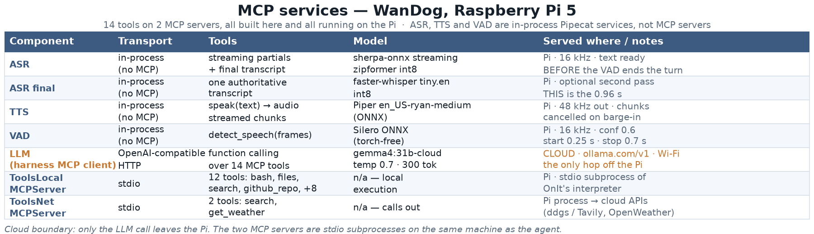

# MCP services

**14 tools on 2 MCP servers. Both were built here, both run on the Pi, both over
stdio.** The harness is the MCP client.

| Component | Transport | Tools | Model | Served where / notes |
|---|---|---|---|---|
| ASR | in-process, **no MCP** | streaming partials + final | sherpa-onnx streaming zipformer int8 | Pi · 16 kHz · text ready **before** the VAD ends the turn |
| ASR final | in-process, **no MCP** | one authoritative transcript | faster-whisper `tiny.en` int8 | Pi · optional second pass · **this is the 0.96 s** |
| TTS | in-process, **no MCP** | `speak(text)` → audio chunks | Piper `en_US-ryan-medium` (ONNX) | Pi · 48 kHz out · chunks cancelled on barge-in |
| VAD | in-process, **no MCP** | `detect_speech(frames)` | Silero ONNX (torch-free) | Pi · 16 kHz · conf 0.6 · start 0.25 s · stop 0.7 s |
| LLM (harness MCP client) | OpenAI-compatible HTTP | function calling over all 14 | `gemma4:31b-cloud`, temp 0.7, 300 tok | **CLOUD** · `ollama.com/v1` · the only hop off the Pi |
| `ToolsLocalMCPServer` | MCP over stdio | 12 tools — see below | n/a, local execution | Pi · subprocess of OnIt's interpreter, `tasks.tools` profile `local` |
| `ToolsNetMCPServer` | MCP over stdio | `search`, `get_weather` | n/a, calls out | Pi process → cloud APIs (ddgs / Tavily, OpenWeather) |
| Task / home-automation | — | **none** | — | **No such server exists in this build** |

## The 14 tools, enumerated at runtime

`mcp_bridge.build_bridge().discover()`, not typed by hand:

| Server | Tools |
|---|---|
| Local (12) | `bash` · `serve` · `read_file` · `write_file` · `edit_file` · `grep` · `send_file` · `github_repo` · `local_search` · `search_document` · `index_documents` · `fetch_content` |
| Net (2) | `search` · `get_weather` |

## Where the template does not match this agent

The template's MCP table has a row for ASR and a row for TTS, both as stdio
servers. WanDog has neither: `SherpaStreamingSTTService` and `PiperTTSService`
are in-process Pipecat services, and so is the VAD. MCP carries the **tools**,
not the audio.

The template also asks for a task MCP server. There is none — the tool set is
shell, files, search and GitHub, with no home-automation or task-tracking schema.

## Two things about the bridge worth knowing

**The result cap is structural, not a slice.** `MCP_MODEL_RESULT_CHARS` is 24,000
and `_cap_for_model` keeps whole results, saying how many were dropped. At the
old 1,200 a five-result news payload arrived as 2 of 5 results, with the
`date` field cut — the model could not tell old news from new.

**The recency rule is in two places on purpose.** The prompt tells the model to
pass `type="news"`; `MCP_NEWS_AUTODETECT` sets the argument when it forgets.
Both were needed, because the event log shows it never passed `type` on its own
in 13 of 13 calls.
