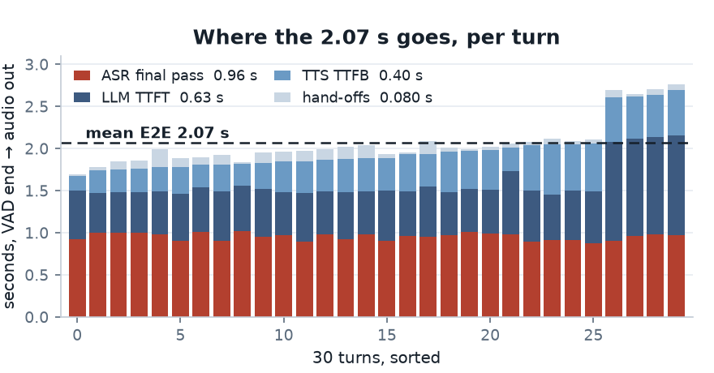

# Summary — WanDog, full-duplex voice agent on a Raspberry Pi 5

## Demo (deck 2) — a 2–3 minute script

1. **A real task, natural turns, no push-to-talk.** *"What's the weather in
   Manila right now?"* — `get_weather` over MCP, a short line while it works, a
   one-sentence answer. Nothing is pressed; the turn ends when you stop talking.
2. **A live MCP tool call with a visible trace.** *"What did I push to GitHub
   last?"* — `github_repo` runs against the real account and the dashboard shows
   the call, its result and the reply. This is the one that proves the tools are
   real rather than described.
3. **Barge-in.** Interrupt mid-sentence. Playback stops in **0.48 s** and the
   agent listens; it does not finish its thought first.
4. **Recovery when the API is slow.** Ask something needing a cloud search and
   interrupt the acknowledgement. The call is not cancelled by the agent's own
   voice — that is what the function-call mute is for — and the answer arrives
   when it arrives instead of the turn collapsing.

Say the caveat out loud: **there is no AEC**, so a demo through a speaker is
louder than through headphones, and the numbers were measured through a socket,
not a room.

## Results (deck 2)

| Metric | Definition | Target | Mean | p95 | n | |
|---|---|---|---|---|---|---|
| E2E latency | VAD end → audio out | < 4.00 s | 2.07 s | 2.70 s | 30 | met |
| E2E heard | true speech end → reply audio | < 4.00 s | 2.71 s | 3.38 s | 30 | met |
| ASR final | VAD end → transcript | < 0.80 s | 0.96 s | 1.01 s | 30 | **over** |
| LLM TTFT | transcript → first token | < 1.50 s | 0.63 s | 1.17 s | 30 | met |
| TTS TTFB | text → first audio chunk | < 0.60 s | 0.40 s | 0.56 s | 30 | met |
| Barge-in | speech → playback stopped | < 0.80 s | 0.48 s | 0.48 s | 2 | met |
| WER | ASR accuracy on test set | < 15 % | 1.37 % | — | 30 | met |

| | |
|---|---|
| Board / RAM | Raspberry Pi 5 Model B Rev 1.0 · 8 GB |
| Cooling | not stated · **peak 68.9 °C** · never throttled |
| CPU | median 6.9 %, busiest core p95 72.3 % |
| Network | cloud over Wi-Fi · benchmark link on the same machine, ~2 ms |
| Date | 2026-11-18 · run `2026-11-18_18-27-10` · 40 trials in 13 min |
| Versions | Pipecat 1.15.0 · sherpa-onnx streaming zipformer `en-2023-06-26` + faster-whisper `tiny.en` · `gemma4:31b-cloud` · Piper `en_US-ryan-medium` · Silero ONNX |

The one number needing a sentence: the 0.96 s ASR figure is **not the
recogniser**. The streaming text is complete 157 ms *before* the VAD ends the
turn; all 0.96 s is the optional whisper `tiny.en` second pass.

## Challenges and references

One fault per row, the fix, and the measurement that proves the fix worked.

| # | Challenge | Fix | Proof |
|---|---|---|---|
| 1 | **Turns cost 5.2 s, 3 s of it silence.** Pipecat 1.15 defaults to Smart Turn, which waits 3 s then asks the STT for text it already has | `SpeechTimeoutUserTurnStopStrategy` at `TURN_STOP_SECS = 1.0` — with streaming ASR the text is in hand when you stop | VAD stop → turn submitted 5.2 → 0.93 s; E2E 2.07 s against a 4.00 s target |
| 2 | **The agent split one question into two at every pause.** One VAD analyzer shared between the `VADProcessor` and the user aggregator, so every 32 ms window was counted twice and every gate ran at half its value | One analyzer per consumer | Fed once → stop 0.710 s (as configured); fed twice → **0.330 s**, and the question split |
| 3 | **Silent while the LLM had answered.** The assistant aggregator sat between the LLM and the TTS and consumed `LLMTextFrame` | Canonical order `llm → tts → output → assistant_agg` | TTS receives text; replies are audible |
| 4 | **Deaf with tools off.** Barge-in was only wired when a tool bridge existed, so the default no-tools configuration had no `InterruptionFrame` | Build the user aggregator unconditionally | Barge-in 0.48 s with tools off — the configuration the benchmark runs |
| 5 | **Tool results were being truncated, losing the answer.** A blind 1,200-character slice dropped most of a 5-result payload and cut the `date` field | Structural cap, keeping whole results and reporting dropped ones; now 8,000 with a 4,000/3,000/2,000 ladder | ddgs news 2 of 5 → **5 of 5**; Tavily 2 of 5 → **5 of 5**; a 12,094-char `read_file` keeps 4,001 instead of 701 |
| 6 | **The agent cancelled the searches it had just announced.** With no AEC its own "Searching for that." came back through the mic and raised a VAD turn start | `FunctionCallUserMuteStrategy` for the duration of a call | 5 of the 7 cancelled tool calls were self-inflicted; the announcement no longer cancels, and barge-in on answers is untouched |
| 7 | **The model never passed `type="news"`** — every search hit the general index, whose results carry no date, so "the latest" was unanswerable | `MCP_NEWS_AUTODETECT` and `_shape_search_args` set the argument, `_sort_news` orders newest-first | Searches return dated results even when the model omits `type`; the prompt keeps only "say the date, do not overclaim" |

### What did not get fixed, and is worth saying

**False turn-taking is 100 % (2 of 2).** It answered a TV clip and a side remark.
Missed turn-taking is 0 %. WanDog has no notion of *address*. The run used 2 of
the 40 `false_tt` clips on disk, so that is 100 % of two, not of forty — raising
`per_round` in `suites.py` is the first next step.

**The context is never trimmed.** It grew 7 → 1,674 conversation tokens and was
never pruned. Past the endpoint's ceiling the turn goes silent rather than
short. Pipecat already ships the trim — `LLMContextSummarizer`, default
thresholds 8,000 tokens / 20 messages — but `enable_auto_context_summarization`
is `False`, so it is off.

## References

- Model Context Protocol — <https://modelcontextprotocol.io>
- Full-Duplex-Bench harness — <https://github.com/trueshotjames/ai231-me3-full-duplex-benchmarking> @ `57eaddbc`
- Pipecat 1.15.0 — <https://docs.pipecat.ai>
- sherpa-onnx — <https://github.com/k2-fsa/sherpa-onnx>
- Piper — <https://github.com/rhasspy/piper>
- Silero VAD — <https://github.com/snakers4/silero-vad>
- This repository — <https://github.com/raesoriano/Full-Duplex-Voice-Agent-WanDog>
- Run logs and raw marks — `bench/results/full-2026-11-18/`
