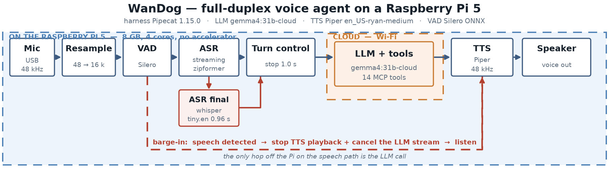

# System diagram — how to read it

Blue dashed = the Raspberry Pi 5. Orange dashed = the cloud. **One hop crosses
that line on the speech path: the LLM call.** Everything else — both
recognisers, the voice, the VAD, all 14 tools — is on the Pi.

## The path, left to right

`Mic → Resample → VAD → ASR → Turn control → LLM + tools → TTS → Speaker`

| Stage | On | What it is |
|---|---|---|
| Mic | Pi | USB PnP card, **48 kHz mono** — this card accepts no other capture rate |
| Resample | Pi | software 48 k → 16 k; Silero accepts only 8 k/16 k |
| VAD | Pi | Silero ONNX in-process, conf 0.6, start 0.25 s, stop 0.7 s |
| ASR | Pi | sherpa-onnx **streaming** zipformer, 16 k, 2 ONNX threads |
| ASR final | Pi | faster-whisper `tiny.en` int8 — optional, and **this is the 0.96 s** |
| Turn control | Pi | `UserTurnController`, stop 1.0 s after the VAD stop |
| LLM + tools | **cloud** | `gemma4:31b-cloud` at `ollama.com/v1`, 14 MCP tools by function calling |
| TTS | Pi | Piper `en_US-ryan-medium`, 48 kHz out |
| Speaker | Pi | USB card, voice out |

## The three things the diagram is actually arguing

**ASR and TTS are not MCP servers.** They are in-process Pipecat services in the
same Python process as the pipeline. The template expects `asr-mcp` and `tts-mcp`
over stdio; this agent has neither. Putting the ASR behind a socket would add
serialisation and a process hop to a stage that already finishes before the turn
ends, and buy nothing — the audio is local and the transcript has one consumer.

**Barge-in is a VAD event, not an instruction.** The red dashed line: speech
detected → the aggregator broadcasts an `InterruptionFrame` → TTS playback stops
and the LLM stream is cancelled. The prompt is not asked to cooperate, because a
model mid-token cannot stop itself.

**The Pi is not the bottleneck.** Median CPU 6.9 %, busiest core p95 72.3 %, peak
68.9 °C, never throttled. The 0.96 s ASR stage is one optional whisper pass, not
compute starvation.

## What the diagram does not show

There is **no echo cancellation**. With no AEC the mic hears the speaker, which
is why the agent's own "Searching for that." used to cancel the search it had
just announced; a `FunctionCallUserMuteStrategy` now covers that window. Self-echo
during ordinary answers was fixed by moving the speaker away from the mic, not in
code. The benchmark's barge-in number was measured through a socket, so it does
not describe barge-in through a speaker in a room.
