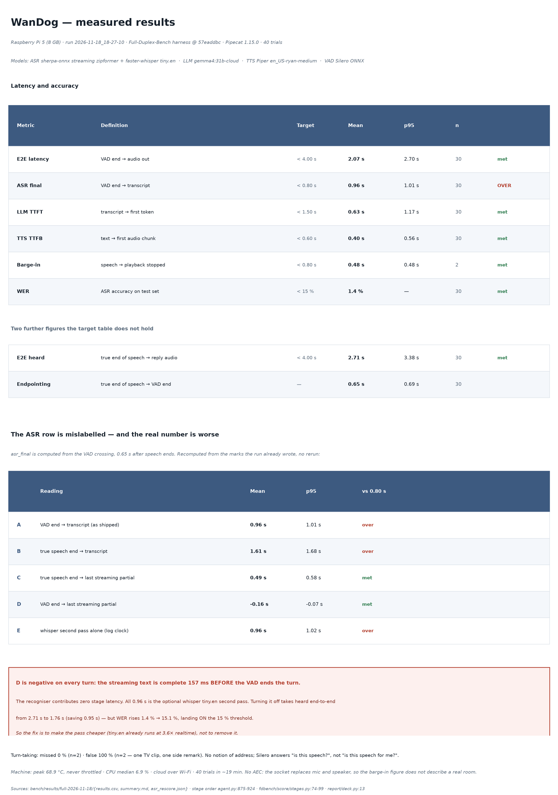

# Evaluation and benchmark — WanDog on a Raspberry Pi 5

Run `2026-11-18_18-27-10` · 2026-11-18 · Raspberry Pi 5 Model B (8 GB)
Harness: [ai231-me3-full-duplex-benchmarking](https://github.com/trueshotjames/ai231-me3-full-duplex-benchmarking)
@ `57eaddbc`, adapted via `bench/assistant_entry.py`

## How it was measured

- **One clock:** the assistant machine's monotonic clock. Every stage is timestamped
  as it crosses: `VAD end → ASR final → LLM 1st token → TTS 1st audio → speaker`.
- **E2E = speaker − VAD end.** Barge-in = stop − speech start.
- **10 phrases × 3 runs**, plus 40 trials across the full suite. Mean + p95 reported;
  a JSON log is kept per run (`stage_latency.json`, per turn `trials/<id>/stages.jsonl`).
- **Tools off.** The benchmark measures turn-taking and stage latency, not tool use,
  and the MCP bridge costs ~5 s of startup per run.
- **No AEC.** The harness replaces mic and speaker with a websocket, so the echo path
  a real room has is absent. The barge-in number below is real but it does not
  describe barge-in over a speaker.

## Results

| Metric | Definition | Target | Mean | p95 | n | |
|---|---|---|---|---|---|---|
| E2E latency | VAD end → audio out | < 4.00 s | 2.07 s | 2.70 s | 30 | met |
| ASR final | VAD end → transcript | < 0.80 s | 0.96 s | 1.01 s | 30 | **over** |
| LLM TTFT | transcript → first token | < 1.50 s | 0.63 s | 1.17 s | 30 | met |
| TTS TTFB | text → first audio chunk | < 0.60 s | 0.40 s | 0.56 s | 30 | met |
| Barge-in | speech → playback stopped | < 0.80 s | 0.48 s | 0.48 s | 2 | met |
| WER | ASR accuracy on test set | < 15 % | 1.4 % | — | 30 | met |

Two further figures the table does not hold:

| Metric | Definition | Mean | p95 | n |
|---|---|---|---|---|
| E2E heard | true end of speech → reply audio | 2.71 s | 3.38 s | 30 |
| Endpointing | true end of speech → VAD end | 0.65 s | 0.69 s | 30 |

E2E passes with 1.9 s of headroom. The **breakdown** is the useful part:

| Stage | Mean | Share of E2E |
|---|---|---|
| ASR final | 0.956 s | 46 % |
| LLM TTFT | 0.633 s | 31 % |
| TTS TTFB | 0.396 s | 19 % |
| hand-offs + playout | 0.080 s | 4 % |
| **E2E** | **2.065 s** | |

ASR is the largest stage and the only missed target. Hand-offs plus playout are
80 ms, so the pipeline itself is not the problem.

## The ASR row is mislabelled, and the real number is worse

`asr_final` is computed as `asr_final_mark − vad_end_mark`
(`score/stages.py:74-99`), but `report/deck.py:13` labels it "end of speech →
transcript". `vad_end` is the VAD crossing, **0.65 s after speech actually ends**.
Recomputing from the marks the run already wrote — no rerun, no audio — gives five
readings of the same 30 turns:

| Reading | Mean | p95 | vs 0.80 s |
|---|---|---|---|
| A  VAD end → transcript (as shipped) | 0.956 s | 1.012 s | over |
| B  true speech end → transcript | 1.607 s | 1.680 s | over |
| C  true speech end → last streaming partial | 0.495 s | 0.580 s | met |
| D  VAD end → last streaming partial | **−0.157 s** | −0.067 s | met |
| E  whisper second pass alone (log clock) | 0.961 s | 1.017 s | over |

Row A reproduces the shipped 0.9556 exactly through the harness's own
`turn_stages`, so this is a recalculation of the same marks, not a rival reading.

**D is negative on every turn.** The streaming zipformer's text is complete
**157 ms before** the VAD decides the turn is over — the recogniser is transcribing
faster than you can be declared finished, and contributes **zero** stage latency.
All 0.96 s is the optional `faster-whisper tiny.en` second pass
(`ASR_FINAL_PASS`, `config.py:112`).

Row E confirms it on an independent clock: the log's wall time rather than the
websocket's monotonic one, agreeing with A to 5 ms mean and 34 ms max.

The decomposition closes, which is what makes the reading trustworthy:

```
endpointing 0.652 + ASR 0.956 + TTFT 0.633 + TTFB 0.396 + handoff 0.080 = 2.712 s
```

against a measured `e2e_heard` of 2.712 s — agreement to 4.6 ms mean.

## What the miss actually costs, and what fixing it costs

The 0.80 s miss is a design choice, not a slow model. With `ASR_FINAL_PASS=none`
the heard end-to-end falls **2.71 → 1.76 s** — 0.95 s, the largest single win
available on this Pi.

The catch is close to fatal:

| Text used | WER | vs 15 % |
|---|---|---|
| whisper final (shipped) | 1.37 % | met |
| streaming flushed | **15.07 %** | at the limit |

Observed streaming output: `SUMMERIZED DAY TO PRIVACY CLEARLY`,
`HOW CAN I PROTECT MY ON MINE ACCOUN`, `HOW CAN I TRADE MY DOG TO FOLLOW BASE A COMMANDS`.

Turning the pass off buys 0.95 s for ~14 points of WER and lands *on* the
threshold, not under it. So the recommendation is not "remove it" but "make it
cheaper": `tiny.en` runs at 3.6× realtime (0.96 s of compute for 3.7 s of audio),
which points at threading or a smaller pass, not at a model that is too big for
the box.

## Turn-taking

| Metric | Rate | n |
|---|---|---|
| Missed turn-taking (failed to answer when addressed) | **0 %** | 2 |
| False turn-taking (answered when not addressed) | **100 %** | 2 |

The failure is one-sided and the n is 2, which is why it is reported as a rate of
two rather than a rate of forty. It answered a TV clip — *"Actually, can you tell
me about sculpting?"* — and a side remark — *"Chris, your laptop's still on the
table, man."*

WanDog has **no notion of address**. Silero VAD answers "is this speech?", not "is
this speech for me?", so any speech in the room opens a turn. Re-running with the
full 40-clip `false_tt` group is the first next step.

## Machine state during the run

| | |
|---|---|
| Board | Raspberry Pi 5 Model B Rev 1.0, 8 GB RAM |
| Cooling | not stated · peak 68.9 °C · never throttled |
| CPU | median 6.9 % |
| Network | cloud over Wi-Fi · benchmark link on the same machine, ~2 ms round trip |
| Harness | Pipecat 1.15.0 |
| ASR | sherpa-onnx streaming zipformer `en-2023-06-26` + faster-whisper `tiny.en` |
| LLM | `gemma4:31b-cloud` |
| TTS | Piper `en_US-ryan-medium` |
| VAD | Silero ONNX |
| Duration | 40 trials, ~19 minutes |

## Reproducing

```bash
bench/run_bench.sh full      # the 40-trial run
bench/run_bench.sh report    # summary + chart
.venv/bin/python bench/rescore_asr.py --from-committed   # the A–E table
```

Raw marks are committed under `bench/results/full-2026-11-18/raw/` because the
submodule git-ignores `runs/` — without that copy the recalculation above would be
unrepeatable the moment the run directory is cleaned.


