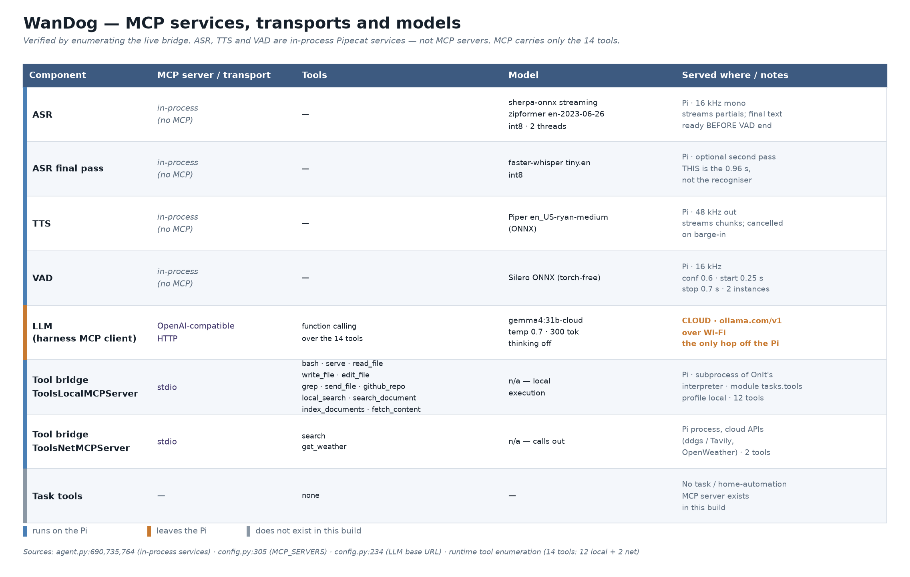

# MCP services — what actually runs, and where

WanDog · verified by enumerating the live bridge (`mcp_bridge.build_bridge().discover()`)

## The correction that matters

The template assumes ASR and TTS are MCP servers. **In this agent they are not.**
Both are in-process Pipecat services in the same Python process as the pipeline —
`SherpaStreamingSTTService` and `PiperTTSService` (`agent.py:764`, `:735`). The
VAD is likewise in-process (`SileroVADAnalyzer`, `agent.py:690`).

MCP is used for **exactly one thing**: the 14 tools. They arrive over stdio from
two of OnIt's own servers, spawned as subprocesses of OnIt's interpreter
(`config.py:305`).

That is a deliberate choice, not an omission. Putting the ASR on the other side of
a socket would add serialisation and a process hop to a stage that already has to
run in real time on a 4-core Pi, and it would buy nothing: there is no second
consumer of the transcript, and the audio is already local.

| Component | MCP server / transport | Tools | Model | Served where / notes |
|---|---|---|---|---|
| ASR | **none — in-process** (`SherpaStreamingSTTService`) | — | sherpa-onnx streaming zipformer `en-2023-06-26`, int8, 2 threads | Pi, 16 kHz mono. Streams partials; final text ready *before* VAD end |
| ASR final pass | **none — in-process** (`faster-whisper`) | — | `tiny.en`, int8 | Pi. Optional second pass. **This is the 0.96 s**, not the recogniser |
| TTS | **none — in-process** (`PiperTTSService`) | — | Piper `en_US-ryan-medium` (ONNX) | Pi, 48 kHz out. Streams chunks; cancelled by `InterruptionFrame` on barge-in |
| VAD | **none — in-process** (`SileroVADAnalyzer`) | — | Silero ONNX (torch-free) | Pi, 16 kHz. `conf 0.6`, start 0.25 s, stop 0.7 s. Two instances — one per consumer |
| LLM (harness MCP client) | **none — OpenAI-compatible HTTP** | function calling over the 14 tools | `gemma4:31b-cloud`, temp 0.7, 300 tok | **Cloud**, `https://ollama.com/v1` over Wi-Fi. The only hop off the Pi |
| Tool bridge | `ToolsLocalMCPServer` / **stdio** | `bash`, `serve`, `read_file`, `write_file`, `edit_file`, `grep`, `send_file`, `local_search`, `search_document`, `index_documents`, `fetch_content`, `github_repo` | n/a — local execution | Pi, subprocess of `/home/raesoriano/onit/.venv/bin/python`, module `tasks.tools`, profile `local` |
| Tool bridge | `ToolsNetMCPServer` / **stdio** | `search`, `get_weather` | n/a — calls out | Pi process, but the APIs are cloud: ddgs/Tavily, OpenWeather |
| Task tools | — | **none** | — | No home-automation or task MCP server exists in this build |

## The 14 tools, as enumerated at runtime

```
ToolsLocalMCPServer (12)
  bash  serve  read_file  write_file  edit_file  grep  send_file
  local_search  search_document  index_documents  fetch_content  github_repo

ToolsNetMCPServer (2)
  search  get_weather
```

## Notes that change how this reads

**The MCP servers are OnIt's, not WanDog's.** WanDog spawns them. The AST command
allowlist, the approval gate and the `DATA_PATH` file jail all live *inside* those
server processes, so WanDog inherits them without re-implementing any of it. That
is the reason to use MCP here at all.

**`github_repo` is a tool, not a server.** It arrives over the local stdio server
like the rest; the GitHub REST API calls it makes are what leave the machine.

**Approval is in the loop.** A tool may return `needs_approval`; the bridge routes
it to a person and waits `MCP_APPROVAL_TIMEOUT = 120 s` before treating silence as
a refusal (fail-closed). While it waits, the agent says so out loud.

**Tool results are capped, not passed through.** `MCP_MODEL_RESULT_CHARS = 24000`,
applied structurally by `_cap_for_model` so a JSON list keeps whole results and
reports how many were dropped. The full payload is still kept for the dashboard.

**No AEC means the tool path can cancel itself.** With no echo cancellation, the
agent's spoken acknowledgement comes back through the mic as speech, raises a VAD
turn start, and interrupts the tool call it just announced. `FunctionCallUserMuteStrategy`
suppresses user frames for the duration of a call to prevent it — measured, 5 of 7
cancelled tool calls were self-inflicted before the mute.

**Latency is not reported for tool calls.** `course.tool_calls` is empty in the
benchmark: the run had tools off, because the benchmark measures turn-taking and
stage latency, and the MCP bridge costs ~5 s of startup per run. So the table above
describes what runs in conversation, not what was timed.


