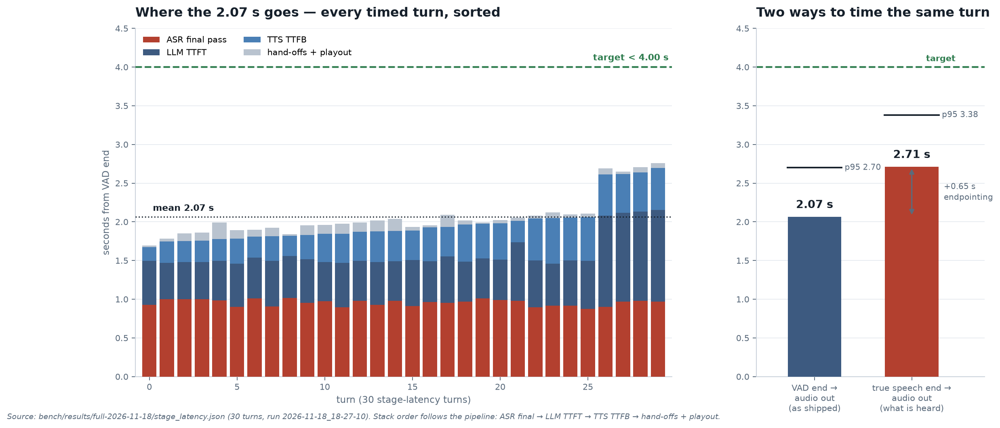

# Summary — WanDog, full-duplex voice agent on a Raspberry Pi 5

## Demo (deck 2)

A 2–3 minute script that shows the four things that are hard:

1. **A real task, natural turns, no push-to-talk.** Ask *"what's the weather in
   Manila right now?"* — the agent calls `get_weather` over MCP, says a short line
   while it works, and answers in one sentence. Nothing is pressed; the turn ends
   when you stop talking.
2. **A live MCP tool call with a visible trace.** Ask *"what did I push to GitHub
   last?"* — `github_repo` runs against the real account, and the dashboard shows
   the call, its result and the reply. This is the one that proves the tools are
   real rather than described.
3. **Barge-in.** Interrupt mid-sentence. Playback stops in **0.48 s** and the agent
   listens — it does not finish its thought first.
4. **Recovery when the API is slow.** Ask something that needs a cloud search and
   interrupt the acknowledgement. The tool call is *not* cancelled by the agent's
   own voice (that is what the function-call mute is for), and the answer arrives
   when it arrives instead of the turn collapsing.

The honest caveat to say out loud: **there is no AEC**, so a demo through a speaker
is louder than a demo through headphones, and the numbers below were measured
through a socket, not a room.

## Results (deck 2)

| Metric | Definition | Target | Mean | p95 | n | |
|---|---|---|---|---|---|---|
| E2E latency | VAD end → audio out | < 4.00 s | 2.07 s | 2.70 s | 30 | met |
| ASR final | VAD end → transcript | < 0.80 s | 0.96 s | 1.01 s | 30 | **over** |
| LLM TTFT | transcript → first token | < 1.50 s | 0.63 s | 1.17 s | 30 | met |
| TTS TTFB | text → first audio chunk | < 0.60 s | 0.40 s | 0.56 s | 30 | met |
| Barge-in | speech → playback stopped | < 0.80 s | 0.48 s | 0.48 s | 2 | met |
| WER | ASR accuracy on test set | < 15 % | 1.4 % | — | 30 | met |

**Machine and run conditions**

| | |
|---|---|
| Board / RAM | Raspberry Pi 5 Model B Rev 1.0 · 8 GB |
| Cooling | not stated · **peak 68.9 °C** · never throttled |
| CPU | median 6.9 % |
| Network | cloud over Wi-Fi · benchmark link on the same machine, ~2 ms round trip |
| Date | 2026-11-18 · run `2026-11-18_18-27-10` · 40 trials in ~19 min |
| Model versions | Pipecat 1.15.0 · ASR sherpa-onnx streaming zipformer `en-2023-06-26` + faster-whisper `tiny.en` · LLM `gemma4:31b-cloud` · TTS Piper `en_US-ryan-medium` · VAD Silero ONNX |

The one number that needs a sentence next to it: the 0.96 s ASR figure is **not the
recogniser**. The streaming text is complete 157 ms *before* the VAD ends the turn;
all 0.96 s is the optional whisper `tiny.en` second pass. See
`Evaluation_Benchmark.md`.

## Challenges and references

Each row is a real fault, the fix, and the measurement that proves the fix worked.

| # | Challenge | Fix | Proof it worked |
|---|---|---|---|
| 1 | **Turns cost 5.2 s, 3 s of it silence.** Pipecat 1.15 defaults to Smart Turn, which waits 3 s of silence then asks the STT for text it already has | `SpeechTimeoutUserTurnStopStrategy` at `TURN_STOP_SECS = 1.0` — with streaming ASR the text is in hand the moment you stop | E2E 2.07 s mean against a 4.00 s target; the stop side no longer contributes 3 s |
| 2 | **The agent split one question into two at every pause.** One VAD analyzer was shared between the `VADProcessor` and the user aggregator, so every 32 ms window was counted twice and every gate ran at half its value | One analyzer per consumer (`agent.py:690`) | On a two-part utterance: shared → stop after **0.33 s** and the question split; separate → **0.71 s**, as configured |
| 3 | **The agent was silent while the LLM had answered.** The assistant aggregator sat between the LLM and the TTS and consumed `LLMTextFrame` | Canonical order `llm → tts → output → assistant_agg` (`agent.py:916`) | TTS receives text; replies are audible |
| 4 | **The agent was deaf with tools off.** Barge-in was only wired when a tool bridge existed, so the default no-tools configuration had no `InterruptionFrame` at all | Build the user aggregator unconditionally (`agent.py:780`) | Barge-in measured at **0.48 s** with tools off — the configuration the benchmark runs |
| 5 | **7 of 7 tool results were being truncated, 2 losing the answer.** A blind 1,200-character slice turned a 5-result news payload into 1.6 broken results, and cut the `date` field the model needed | Structural cap at **24,000** chars, keeping whole results and reporting how many were dropped (`config.py:360`) | ddgs news 2/5 → **5/5**; Tavily 2/5 → **5/5**; `read_file` clipped → whole |
| 6 | **The agent cancelled the searches it had just announced.** With no AEC, its own "Searching for that." came back through the mic and raised a VAD turn start | `FunctionCallUserMuteStrategy` for the duration of a call (`agent.py:820`) | **5 of 7** cancelled tool calls were self-inflicted before; the announcement no longer interrupts the call, and barge-in on answers is untouched |
| 7 | **The model never passed `type="news"`** — 13 of 13 search calls hit the general index, whose results carry no date, so "the latest" was unanswerable | Recency guidance in the prompt **and** `MCP_NEWS_AUTODETECT` as the second half of the fix | Searches now return dated results; the prompt rule and the argument default cover the model forgetting |

### What did not get fixed, and is worth saying

**False turn-taking is 100 %** (2 of 2): it answered a TV clip and a side remark.
Missed turn-taking is 0 % — it never fails to answer when addressed. WanDog has no
notion of *address*; Silero VAD answers "is this speech?", not "is this speech for
me?". n=2, so that is 100 % of two, not of forty.

**The context is never trimmed.** It grew 7 → 1,674 tokens over the run and was
never pruned. Past the endpoint's ceiling the turn goes silent rather than short.

## References

- Model Context Protocol — <https://modelcontextprotocol.io>
- Full-Duplex-Bench harness — <https://github.com/trueshotjames/ai231-me3-full-duplex-benchmarking> @ `57eaddbc`
- Pipecat 1.15.0 — <https://docs.pipecat.ai>
- sherpa-onnx streaming zipformer — <https://github.com/k2-fsa/sherpa-onnx>
- Piper TTS — <https://github.com/rhasspy/piper>
- Silero VAD — <https://github.com/snakers4/silero-vad>
- This repository — <https://github.com/raesoriano/Full-Duplex-Voice-Agent-WanDog>
- Run logs and raw marks — `bench/results/full-2026-11-18/` (`results.csv`, `summary.md`, `stage_latency.json`, `asr_rescore.json`, `raw/`)
