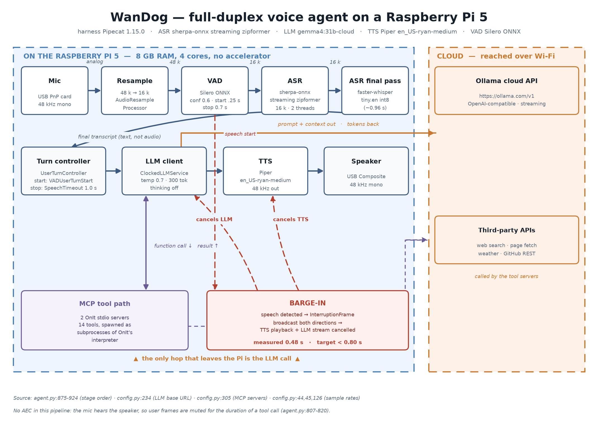

# System diagram — how to read it



Two zones, one boundary. Everything inside the blue dashed box runs on the
Raspberry Pi 5; everything in the orange box is reached over Wi-Fi. **One hop
crosses that line on the speech path: the LLM call.**

## The audio path, left to right

`Mic → Resample → VAD → ASR → [ASR final pass] → Turn controller → LLM → TTS → Speaker`

| Stage | Runs on | What it is |
|---|---|---|
| Mic | Pi | USB PnP card, **48 kHz mono** — this card accepts no other capture rate |
| Resample | Pi | `AudioResampleProcessor`, 48 k → 16 k. Silero accepts only 8 k/16 k |
| VAD | Pi | Silero ONNX, in-process. `conf 0.6`, start 0.25 s, stop 0.7 s |
| ASR | Pi | sherpa-onnx **streaming** zipformer, 16 k, 2 ONNX threads |
| ASR final pass | Pi | faster-whisper `tiny.en` int8 — optional, and it is the 0.96 s |
| Turn controller | Pi | `UserTurnController`: VAD start, `SpeechTimeout` 1.0 s stop |
| LLM | **cloud** | `gemma4:31b-cloud` at `https://ollama.com/v1`, OpenAI-compatible |
| TTS | Pi | Piper `en_US-ryan-medium`, 48 kHz out |
| Speaker | Pi | USB Composite Device, 48 kHz mono |

The mic and the speaker are two different USB cards, pinned by device index, so
the agent cannot pick the wrong one.

## Why the diagram shows *two* ASR boxes

Because the code has two stages, and the distinction is the most important thing
on this page. The streaming zipformer decodes as you speak — its last interim
lands **157 ms before** the VAD even decides you have stopped. The final pass
(`faster-whisper tiny.en`) then re-transcribes the same audio for accuracy, and
costs **0.96 s** on this Pi.

So the recogniser is effectively free and the *optional accuracy pass* is the
entire measured ASR latency. Turning it off takes end-to-end from 2.71 s to
1.76 s, at a cost of ~14 points of WER (1.4 % → 15.1 %). That is a design
decision, and it belongs on the diagram rather than buried in a table.

## The tool path

`LLM client ⇄ MCP tool path ⇄ third-party APIs`

WanDog's tools are **not** MCP servers that WanDog wrote. It spawns OnIt's own
stdio servers as subprocesses of OnIt's interpreter (`config.py:305`):

- `ToolsLocalMCPServer` — `tasks.tools`, profile `local`
- `ToolsNetMCPServer` — `tasks.tools`, profile `net`

14 tools in total, listed in `MCP_Services.md`. The safeguards — AST command
allowlist, approval gate, `DATA_PATH` file jail — live *inside* those server
processes, so WanDog inherits them without re-implementing any of it.

The servers are local; the APIs they call are not. That is why the purple dashed
line crosses into the orange box.

## Barge-in

`speech detected → InterruptionFrame → cancel TTS playback + cancel LLM stream → listen`

The VAD's turn *start* raises the interruption, so it fires on the first speech
frame rather than waiting for a transcript. Measured **0.48 s** from speech to
playback stopped, against a 0.80 s target.

Two things worth knowing that the diagram states in the footer:

**There is no AEC.** No `pywebrtc_audio` filter, no Speex. The mic hears the
speaker. Barge-in numbers measured through a socket (as in the benchmark) say
nothing about barge-in through a speaker, because the socket removes the echo
path that dominates in the real room.

**User frames are muted during a tool call.** `FunctionCallUserMuteStrategy`
suppresses VAD frames for exactly as long as a function call is in flight —
without it, the agent's own spoken acknowledgement ("Searching for that.") came
back through the mic and cancelled the search it had just announced. 5 of 7
cancelled tool calls were self-inflicted. Barge-in on the agent's *answers* is
untouched.

## What is *not* in the diagram, because it does not exist

- **No AEC** filter in the pipeline.
- **No separate ASR/TTS MCP server.** Both are in-process Pipecat services. Only
  the 14 tools come over MCP.
- **No context trimming.** The message list grows unbounded for the session.
- **No local LLM.** The model is cloud-hosted; the Pi never runs it.

## How the image is generated

`bench/gen_diagram.py` — Matplotlib, no external assets. Every label is taken
from the code, and the source line for each claim is in the figure footer:

```
.venv/bin/python bench/gen_diagram.py
```
